<p align="center">
  
</p>

<p align="center">
  
  
  
  
</p>

# eBPF

Ein lokales Linux-Labor für Paketfilter, Lastverteilung und Netzwerkregeln. Mit eigenem XDP-Programm, Cilium und Hubble. Die Weboberfläche führt die Versuche aus und zeigt Messwerte, Netzwerkereignisse und Server-Logs.

## Starten

Docker Desktop und ein [eingerichtetes Labor](lab/README.md) vorausgesetzt:

```sh
docker compose up --build -d --wait
```

Öffnen: [localhost:5173](http://127.0.0.1:5173/)

Stoppen:

```sh
docker compose down
```

## Dokumentation

[Docker-Setup](docs/DOCKER.md) · [Linux-Labor](lab/README.md) · [Quellen und Lizenzen](public/vendor/ATTRIBUTION.md)
